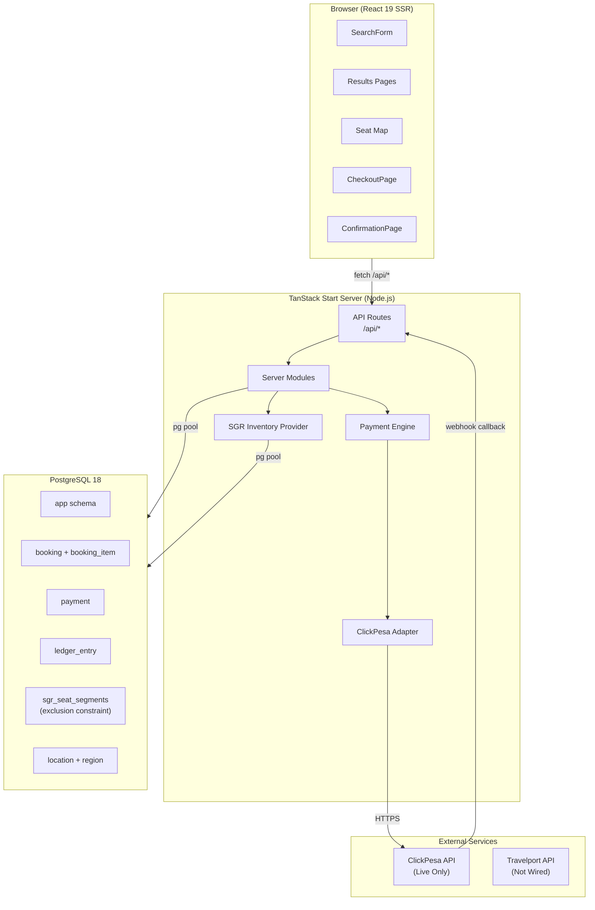
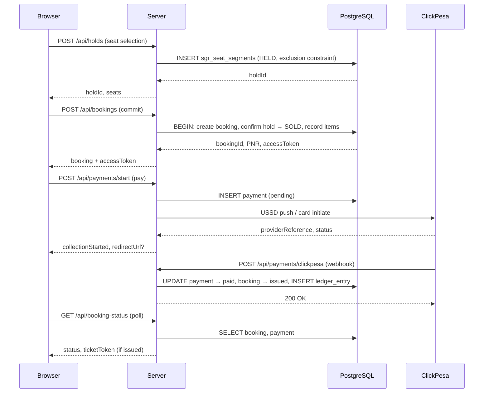

# 01 — System Overview

**Audit date:** 2026-11-01  
**Auditor:** Independent Engineering Team

---

## 1. Product Description

**Travelar** is a multi-modal transport booking platform for the Tanzanian market. It allows passengers to search, compare, select seats, pay, and receive tickets for:

- **Bus** — intercity routes with live seat maps, LATRA-regulated operators
- **Train (SGR)** — Tanzania Railways Corporation Standard Gauge Railway, segment-based seat inventory
- **Ferry** — Dar es Salaam ↔ Zanzibar, resident/non-resident pricing
- **Flights** — domestic, fixture/mock data only (Travelport integration planned)
- **Stays** — accommodation, fixture/mock data only
- **Experiences** — activities, fixture/mock data only

Only bus and SGR train modes are backed by live database inventory and real payment processing. All other modes read from static TypeScript fixture modules.

---

## 2. Technology Stack

| Layer | Technology | Version |
|---|---|---|
| Framework | TanStack Start (React SSR) | ^1.121.1 |
| UI Library | React | 19.1.0 |
| Language | TypeScript | ~5.5 |
| Build Tool | Vite | ^8.0.0-beta.1 |
| CSS | TailwindCSS | v4.1 |
| Database | PostgreSQL | 18 (target) |
| DB Driver | pg (node-postgres) | ^8.16.0 |
| Payments | ClickPesa API | Live (no sandbox) |
| Deployment | Vercel (serverless) | — |
| Production server | srvx | ^0.3.3 |
| Unit Testing | Vitest | ^3.2.1 |
| E2E Testing | Playwright | ^1.52.0 |
| Linting | ESLint | ^9.27.0 |
| Icons | Lucide React | ^0.485.0 |

### Notable Dependencies
- `crypto` (Node built-in) — HMAC-SHA256 for booking access tokens, payment checksums, ticket tokens
- `QRCode` (via `qrcode` npm) — ticket verification QR codes
- No ORM — raw SQL with parameterized queries throughout
- No external auth provider wired in production (Supabase listed but unused; Keycloak in ADR only)

---

## 3. Architecture

### Architecture Style
**Modular monolith** — a single deployable unit with clear internal module boundaries. Server-side code is organized into purpose-specific modules (`payments.ts`, `bookings.ts`, `holds.ts`, `expiry.ts`, etc.) with a provider abstraction layer for inventory (`sgr/provider.ts`).

### Key Architectural Patterns
1. **Server-side pricing** — the client never decides what to charge; quotes come from `app.sgr_fares` or server-side `quote.ts`
2. **Database-enforced inventory** — double-sell protection via PostgreSQL exclusion constraint (`sgr_seat_segments_no_overlap`), not application-level checks
3. **Segment-based seat inventory** — a seat can be sold for partial journeys (Dar→Morogoro, then Morogoro→Dodoma)
4. **Guest booking with HMAC tokens** — no user accounts required; each booking gets a signed access token
5. **Idempotent payment confirmation** — keyed on `(provider, order_reference)`
6. **Append-only ledger** — revenue is recorded via reversal rows, never updates

---

## 4. Module Map

### Server Modules (`src/server/`)

| Module | Lines | Responsibility |
|---|---|---|
| `payments.ts` | 1065 | Full payment lifecycle: create, start, confirm, query |
| `payments/clickpesa.ts` | 482 | ClickPesa adapter: USSD push, card, preview, status |
| `payments/phone.ts` | 59 | MSISDN normalization |
| `payments/checksum.ts` | 76 | HMAC checksum for ClickPesa |
| `search.ts` | 365 | Location and trip search |
| `bus-results.ts` | 235 | Bus search results |
| `bookings.ts` | 308 | Booking commit + status |
| `seat-map.ts` | 225 | Seat map reads |
| `booking-access.ts` | 80 | HMAC access token generation/verification |
| `ticket-token.ts` | 65 | QR code verification tokens |
| `holds.ts` | 107 | Bus seat hold management |
| `expiry.ts` | 126 | Reservation expiry sweep |
| `ledger.ts` | 72 | Revenue recording |
| `quote.ts` | 91 | Server-side pricing for bus trips |
| `config.ts` | 155 | Environment configuration |
| `db.ts` | 103 | Connection pool + transaction helper |

### SGR Modules (`src/server/sgr/`)

| Module | Lines | Responsibility |
|---|---|---|
| `inventory.ts` | 374 | Materialise trips, hold/confirm/release seats |
| `services.ts` | 332 | SGR corridor search, fare lookup, quoting |
| `read-models.ts` | 272 | Class availability + car seat state read models |
| `provider.ts` | 114 | Provider abstraction (ALLOCATED_BLOCK today) |
| `layouts.ts` | 445 | Deterministic coach layout generators (EMU + Express) |
| `layout-repository.ts` | 176 | Read layouts from database |

### Frontend (`src/pages/`, `src/components/`, `src/context/`)

| Module | Size | Responsibility |
|---|---|---|
| `I18nContext.tsx` | ~100KB | Inline translations dictionary (EN, SW) |
| `CheckoutPage.tsx` | 830 lines | Payment form + booking creation |
| `AppContext.tsx` | 153 lines | Global booking state |
| `AuthContext.tsx` | 123 lines | **Stub** — localStorage-only, no real auth |
| `SearchForm.tsx` | ~27KB | Multi-modal search input |

### Domain (`src/domain/`)

| Module | Lines | Responsibility |
|---|---|---|
| `pricing.ts` | 264 | Client-side quote calculations (all modes) |
| `money.ts` | 20 | Currency symbol map |
| `passengers.ts` | 26 | Party mix validation |
| `search.ts` | 70 | Location alias resolution |

---

## 5. Data Flow: Booking Lifecycle

---

## 6. Database Schema Summary

**19 migrations** in `db/migrations/`, applied sequentially with checksum verification.

### Core Tables (app schema)

| Table | Purpose |
|---|---|
| `location` | Searchable places (city, town, station, port, airport) |
| `region` | Administrative regions (FK from location) |
| `operator` | Bus/ferry operators with LATRA licence |
| `vehicle` | Buses with class, amenities, seat count |
| `route` | Operator routes between locations |
| `trip` | Dated bus services |
| `booking` | Bookings with status lifecycle |
| `booking_item` | Per-passenger ticket items |
| `payment` | Payment attempts per booking |
| `ledger_entry` | Append-only revenue ledger |
| `seat_layout` | Bus seat map grids |
| `seat_layout_cell` | Individual cells in seat maps |
| `sgr_trainset_types` | Rolling stock types (EMU, Express) |
| `sgr_seat_classes` | ROYAL, BUSINESS, ECONOMY |
| `sgr_coach_layouts` | Versioned coach interiors |
| `sgr_layout_seats` | Individual seats per coach layout |
| `sgr_trips` | Dated SGR services with layout snapshot |
| `sgr_trip_seats` | Per-seat inventory for a trip |
| `sgr_seat_segments` | Segment-based availability (exclusion constraint) |
| `sgr_holds` | Seat hold records |
| `sgr_fares` | LATRA-approved fares per corridor/class/pattern |
| `route_corridor` | LATRA corridor reference data |

### Key Constraints
- `sgr_seat_segments_no_overlap` — GiST exclusion prevents double-sell
- `ux_payment_open_per_booking` — one open payment per booking
- `ux_seat_sold_once` — partial unique prevents double-sell on bus seats
- `ux_payment_order_reference` — unique per provider + reference

---

## 7. Entry Points

| Entry Point | Purpose |
|---|---|
| `app.config.ts` → Vite/TanStack Start | Application bootstrap |
| `src/routes/__root.tsx` | Root layout (providers, meta, CSP) |
| `src/router.tsx` | Route tree |
| `src/routes/api.*.ts` (14 files) | API endpoints |
| `scripts/migrate.mjs` | Database migration runner |
| `scripts/seed-*.mjs` | Data seeding scripts |

