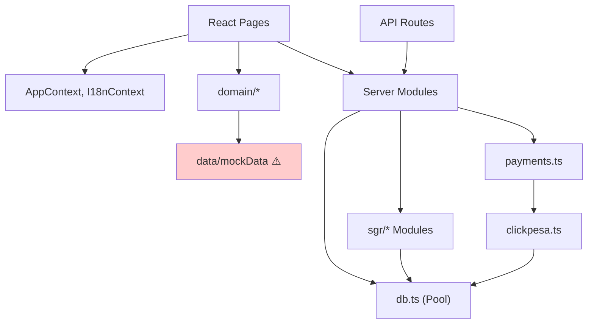

# 02 — Architecture Audit

**Audit date:** 2026-11-01  
**Perspective:** Principal Software Architect

---

## 1. Overall Assessment

The architecture is a **well-structured modular monolith** that is appropriate for the application's current stage. Module boundaries are clean, dependency direction is mostly correct, and the domain's most critical invariant (no double-selling of seats) is correctly delegated to the database.

**Grade: B+** — Strong fundamentals with two structural gaps (authentication and multi-modal parity) that must be resolved before production scale.

---

## 2. Separation of Concerns

### Correct Separations

| Concern | Location | Assessment |
|---|---|---|
| Persistence | `src/server/db.ts` | Single pool, transaction helper. No ORM — SQL is explicit and auditable. ✅ |
| Domain pricing | `src/domain/pricing.ts` | Client-side quote module, single source of truth per mode. ✅ |
| Server-side pricing | `src/server/quote.ts`, `src/server/sgr/services.ts` | Server prices from DB; client never decides what to charge. ✅ |
| Payment orchestration | `src/server/payments.ts` | Orchestrator delegates to adapter (`clickpesa.ts`). ✅ |
| Inventory provider | `src/server/sgr/provider.ts` | Abstraction layer with capability interface. Ready for PUSH_SYNC/LIVE_VERIFY. ✅ |
| Seat geometry | `src/server/sgr/layouts.ts` | Generator functions, deterministic, tested against operator data. ✅ |
| Internationalisation | `src/context/I18nContext.tsx` | ⚠️ Correct in concept but monolithic in implementation (H-005). |

### Violations

1. **AuthContext mixes UI state with security boundary** — `AuthContext.tsx` pretends to be an auth provider but is a localStorage facade. This conflates "what the UI shows" with "who has access to what". The two must be separated: a server-side session/JWT for access control, and a client-side user context for display.

2. **Fixture modules act as a production data source** — `src/data/mockData.ts` (flights, stays, experiences) is imported alongside real data sources. There is no clear boundary between "demo/fixture" and "live inventory". The `pricing.ts` module imports from both in the same switch statement.

3. **I18n translations are coupled to the React tree** — translations live in a Context provider, meaning every string change requires a full application rebuild and redeploy. This is a deployment architecture issue, not just a code quality one.

---

## 3. Dependency Direction

**Correct directions:**
- Routes depend on server modules, never the reverse ✅
- SGR modules depend on `db.ts`, never on routes ✅
- `provider.ts` depends on `inventory.ts` and `read-models.ts`, never the reverse ✅
- `payments.ts` depends on `clickpesa.ts` adapter, never the reverse ✅

**Incorrect direction:**
- `domain/pricing.ts` → `data/mockData.ts` — a domain calculation module depends on a fixture data module. This should be inverted: the domain module should receive data, not fetch it. ⚠️

---

## 4. Modularity Assessment

### Can Modules Evolve Independently?

| Module | Independent? | Notes |
|---|---|---|
| Bus booking | ✅ Yes | Routes, search, seat map, holds — all self-contained |
| SGR train booking | ✅ Yes | Provider abstraction allows swapping inventory source |
| Payment processing | ✅ Yes | Adapter pattern; adding a new provider = new adapter file |
| Ferry booking | ⚠️ Partially | Still reads from fixture data; no server-side inventory |
| Flights | ❌ No | Entirely fixture-based; Travelport config exists but nothing calls it |
| Auth | ❌ No | Stub; every module that needs auth has zero foundation to build on |

### Circular Dependencies

**None found.** The import graph is acyclic. Server modules import from `db.ts` and each other in a DAG. Frontend pages import from contexts and domain modules in a tree.

---

## 5. Architectural Scalability

### Current Architecture Supports

| Dimension | Assessment |
|---|---|
| More bus operators | ✅ Data-driven: add operator, vehicle, route rows |
| More SGR corridors | ✅ Data-driven: add trips, stops, fares |
| More seat classes | ✅ Lookup table, not enum |
| More payment providers | ✅ Adapter pattern in `payments.ts` |
| More languages | ⚠️ Possible but requires code change (H-005) |
| More countries | ⚠️ Hardcoded +255 prefix (M-008), hardcoded UTC+3 (L-008) |
| More concurrent users | ⚠️ No caching, no CDN config, no read replicas |
| Admin users with roles | ❌ No auth foundation (C-001, C-002) |

### Architectural Bottlenecks

1. **Single PostgreSQL connection pool** — all reads and writes go through one pool. Under high concurrency, the pool (default 10 connections) will saturate. Mitigation: read replicas + pool configuration.

2. **No caching layer** — every search, every seat map read hits the database. For repeated queries (e.g. popular routes), this is wasteful. Mitigation: Redis or in-memory cache for read models.

3. **Synchronous webhook processing** — the ClickPesa webhook handler processes payment confirmation synchronously (booking update + ledger entry in one transaction). If the transaction is slow, ClickPesa may time out and retry. Mitigation: acknowledge webhook immediately, process asynchronously.

---

## 6. Configuration Assessment

### Well-Configured

- Environment variables for all secrets ✅
- `config.ts` validates and normalizes all env vars ✅
- Travelport config throws on half-configuration ✅
- Database URL normalization handles both `postgres://` and `postgresql://` ✅

### Hardcoded Values That Should Be Configurable

| Value | Location | Issue |
|---|---|---|
| UTC+3 offset | `sgr/services.ts:20` | Hardcoded for Tanzania |
| +255 country code | `CheckoutPage.tsx:581` | Hardcoded for Tanzania |
| `CHILD_FARE_RATE = 0.5` | `pricing.ts:62` | Business rule in code |
| `STAY_TAX_RATE = 0.18` | `pricing.ts:65` | Tax rate in code |
| Mobile money provider list | `data/locations.ts` | Market config, not DB-driven |

---

## 7. Recommendations

### Keep (Architectural Strengths)

1. **Modular monolith** — correct for this stage. Do not split into microservices.
2. **Database-enforced invariants** — the exclusion constraint and partial unique indexes are the right patterns.
3. **Provider abstraction** — the `SgrInventoryProvider` interface is well-designed for future PUSH_SYNC/LIVE_VERIFY modes.
4. **Server-side pricing** — prevents client manipulation. Must be preserved.
5. **Idempotent payment confirmation** — correct and safe.

### Fix (Architectural Gaps)

1. **Implement real authentication** — the single most important architectural change.
2. **Separate fixture modes from production** — either gate non-live modes behind a feature flag or remove them from the booking/payment path.
3. **Extract translations** — move to file-based i18n before the dictionary doubles.
4. **Add a caching layer** — at minimum for search results and seat availability read models.
5. **Add structured logging** — essential for production observability.

