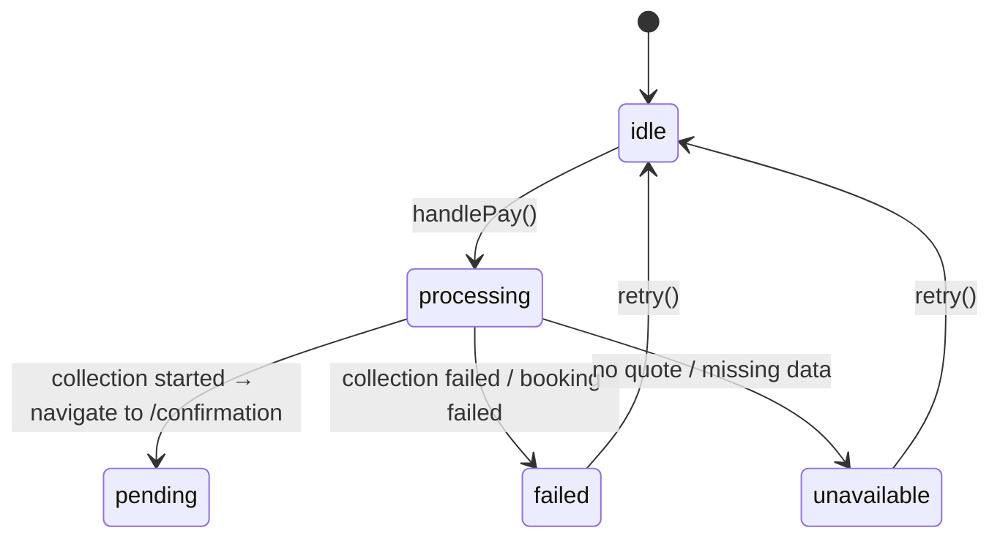

# 04 — Frontend Audit

**Audit date:** 2026-11-01  
**Perspective:** Senior Frontend Engineer

---

## 1. Overall Assessment

The frontend is a **well-organized React 19 SSR application** using TanStack Start. Component architecture follows sensible patterns, state management is minimal and appropriate, and the UI handles payment flows with care. The main concerns are the monolithic I18n file, stub authentication, and several hook dependency warnings.

**Grade: B** — Functional and well-structured, with maintainability issues that will compound as features are added.

---

## 2. Component Architecture

### State Management

**`AppContext.tsx` (153 lines)** — Clean, minimal global state.

- Booking state is a flat object with individual setters wrapped in `useCallback` ✅
- `resetBooking` correctly creates a fresh default state per mode ✅
- `activeBooking` stores the server's state, not the component's opinion — the comment at line 16-19 makes this explicit ✅
- No prop drilling: contexts are consumed via `useApp()` and `useAuth()` hooks ✅

**Concern:** All booking state is in-memory React state. A page refresh loses the entire booking flow. For the current guest-booking model this is acceptable (the server holds the truth), but it means a customer who refreshes mid-checkout loses their UI context.

### Authentication Context

**`AuthContext.tsx` (123 lines)** — **STUB** (see C-001 in Security Audit)

- `signInWithEmail` ignores the password (line 89-91)
- `signInWithProvider` returns hardcoded fake users (line 99-103)
- `normalizeUser` at line 29-44 is well-written defensive parsing, but it validates data that is never real
- The comment at line 23-28 correctly warns this is "never an authorisation boundary" — but nothing else provides one

### I18n Context

**`I18nContext.tsx` (~1383 lines / ~100KB)** — Finding H-005

- Two complete translation dictionaries (EN, SW) inline in a single file
- Every UI string change requires editing this file
- The file is the largest single source file in the project
- Git merge conflicts will be frequent as features are added

---

## 3. Checkout Flow

**`CheckoutPage.tsx` (830 lines)** — The most complex frontend component.

### Strengths

1. **Server-side quote fetching** (lines 107-170): The SGR flow fetches pricing from `/api/sgr/trips/:id/quote` on mount, using a `useEffect` with proper cleanup via `AbortController`. The client never decides the price.

2. **Idempotent booking creation** (lines 320-377): If `activeBooking` already exists with `pending_payment` status, the checkout reuses it instead of creating a duplicate. This prevents double-booking on retry.

3. **Two-phase payment** (lines 297-457): Booking creation and payment initiation are separate API calls. A failed payment does not lose the booking — the seats stay held.

4. **Redirect handling** (lines 436-438): Card payments redirect to the provider's hosted page via `window.location.assign`, keeping the origin out of PCI scope.

5. **Error handling** (lines 258-277): Provider reason codes are mapped to user-facing copy via `reasonCopy()`.

### Findings

| ID | Issue | Lines | Severity |
|---|---|---|---|
| M-008 | Phone prefix hardcoded to `+255` | 580-582 | MEDIUM |
| — | `void (async () => { ... })()` pattern | 297 | Style: correct but unusual; a named async function would be clearer |
| — | `handlePay` is 160+ lines | 279-457 | Refactoring opportunity: extract booking creation and payment initiation into separate functions |

### Payment Status State Machine

This state machine is correct and well-implemented. The UI disables the pay button during processing and shows appropriate status strips.

---

## 4. Data Flow

### Correct Patterns

- **Server-driven pricing:** The checkout page fetches the server quote and uses it as the authoritative amount. The client-side `quoteForBooking()` in `domain/pricing.ts` is used only for non-SGR modes where the server does not yet have a quote endpoint.

- **Access token propagation:** The booking access token from the server response is stored in `activeBooking` and sent with subsequent `/api/payments/start` and `/api/booking-status` requests.

- **No optimistic updates for financial operations:** The UI waits for server confirmation before navigating to the confirmation page.

### Concern: Dual Pricing Path

For bus mode, the checkout page fetches a server-side quote. For all other modes (ferry, flights, stays, experiences), pricing comes from `domain/pricing.ts` which reads fixture data. This creates a **divergence risk**: if the bus path's quote endpoint returns a different amount than the client-side calculation, the customer sees one price and is charged another.

Currently this is safe because the server's `bookings.ts` re-prices from the database. But the UI should always show the server's price, not a client-side estimate.

---

## 5. Form Handling

### Passenger Form

The passenger form collects:
- Full name (required)
- Category (adult/child)
- Phone with country code
- Email
- Seat assignment

**Finding:** No client-side validation beyond "required" fields. Empty strings, invalid emails, and malformed phone numbers are accepted by the UI and only caught (if at all) by the server.

### Search Form

**`SearchForm.tsx` (~27KB)** — Handles all modes (bus, train, ferry, flights, stays, experiences).

- Mode switching resets form fields appropriately ✅
- Date picker enforces future dates ✅
- Location autocomplete uses the `data/locations.ts` dataset ✅

---

## 6. Rendering Performance

### Concerns

1. **I18n context re-renders:** Every `useI18n()` consumer re-renders when the language changes. Since the translation dictionary is a 100KB object, this could cause janky re-renders on low-end devices.

2. **Seat map re-renders:** `CoachSeatMap` renders up to 90 seats per coach. Selection state changes trigger a full re-render of all seats. For the current seat counts (up to 78 per coach), this is acceptable. For larger vehicles, memoization would be needed.

3. **No virtualization:** Bus results, train results, and ferry results are rendered as full lists without virtualization. For the current dataset sizes (< 20 results), this is fine.

### Positive

- `useCallback` is used consistently for context setters, preventing unnecessary re-renders of consumers ✅
- No unnecessary `useEffect` chains — data fetching is done once on mount ✅

---

## 7. Accessibility

### Implemented

- `aria-pressed` on mobile money provider buttons ✅
- `aria-describedby` linking phone input to hint text ✅
- `role="alert"` on error messages ✅
- `role="status"` and `aria-live="polite"` on payment progress ✅
- `aria-hidden="true"` on decorative icons ✅
- `<fieldset disabled>` during processing ✅
- `<legend>` for payment method group ✅

### Missing

- No skip navigation link
- No focus management after payment status changes
- Seat map interaction relies on click/tap only — no keyboard navigation for seat selection
- No `aria-label` on the seat map grid cells
- Color alone distinguishes available/sold/held seats — no pattern or icon alternative

---

## 8. Responsive Behaviour

- `sm:` breakpoint used consistently for desktop layout adjustments ✅
- Mobile-first design with stacking on small screens ✅
- `max-w-2xl` and `max-w-5xl` containers prevent excessive width on large screens ✅
- Touch targets: mobile money provider buttons have `min-h-11` ✅

---

## 9. React-Specific Findings

| Finding | File | Lines | Impact |
|---|---|---|---|
| M-011: Duplicate React key `1-3` | `CoachSeatMap` | test stderr | Incorrect reconciliation, potential UI bugs |
| M-012: Missing `useEffect` dependencies | `BusBookingPage:217`, `BusReviewPage:112`, `FlightBookingPage:39` | — | Stale closures; effects may not re-run when expected |
| `react-refresh/only-export-components` warnings (×13) | Various | — | No production impact; slower HMR |

---

## 10. Recommendations

1. **Extract I18n to JSON files** (H-005) — highest maintainability impact
2. **Add client-side form validation** — prevent invalid data reaching the server
3. **Add keyboard navigation to seat maps** — accessibility requirement
4. **Fix duplicate React keys** (M-011) — potential rendering bugs
5. **Add explicit `eslint-disable` with comments** for intentional dependency omissions (M-012)
6. **Always show server price** — eliminate the dual pricing path for non-SGR modes

