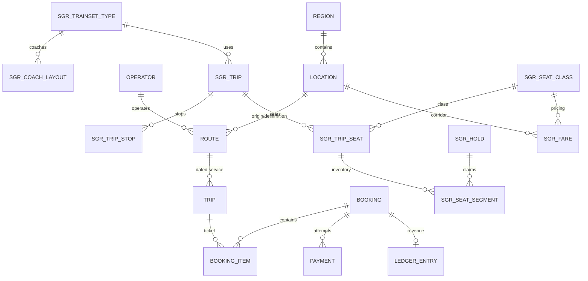

# 05 — Database Audit

**Audit date:** 2026-11-01  
**Perspective:** Database Architect  
**Database:** PostgreSQL 18, `app` schema

---

## 1. Overall Assessment

The database design is **excellent**. Schema design shows a deep understanding of the domain, financial safety, and concurrency. The migration quality is unusually high — each migration has a narrative comment explaining the business reason, not just the DDL.

**Grade: A-** — The segment-based inventory model and exclusion constraint are best-in-class. Minor issues with migration tooling and a few missing indexes.

---

## 2. Schema Design

### Core Design Decisions (All Correct)

| Decision | Implementation | Why It's Right |
|---|---|---|
| Money as `bigint` + currency | `booking.total_minor bigint`, `payment.amount_minor bigint` | No floating-point rounding. Explicit currency prevents silent conversion. |
| Append-only ledger | `ledger_entry` with reversal rows, never updates | Audit trail is immutable. Revenue calculations are simple sums. |
| Segment-based seat inventory | `sgr_seat_segments (trip_seat_id, from_seq, to_seq, state)` | A seat sold Dar→Morogoro stays available Morogoro→Dodoma. |
| Exclusion constraint for double-sell | `sgr_seat_segments_no_overlap` using GiST | Database enforces the invariant, not application code. Survives concurrent writes. |
| Layout snapshots in trips | `sgr_trips.layout_snapshot jsonb` | A reconfigured coach does not change a ticket already sold. |
| Separate `booking` and `payment` | One booking, many payment attempts | A failed payment does not lose the booking. |
| Versioned coach layouts | `sgr_coach_layouts (trainset_type_id, coach_no, version)` | An edit creates a new version; the old one is never mutated. |

### Entity-Relationship Overview

---

## 3. Referential Integrity

### Foreign Keys (All Present)

| Table | FK | Target | Cascade |
|---|---|---|---|
| `sgr_trips.trainset_type_id` | → | `sgr_trainset_types.id` | No cascade (correct: don't delete trips if trainset is removed) |
| `sgr_trip_stops.trip_id` | → | `sgr_trips.id` | `ON DELETE CASCADE` ✅ |
| `sgr_trip_seats.trip_id` | → | `sgr_trips.id` | `ON DELETE CASCADE` ✅ |
| `sgr_seat_segments.trip_seat_id` | → | `sgr_trip_seats.id` | `ON DELETE CASCADE` ✅ |
| `sgr_seat_segments.hold_id` | → | `sgr_holds.id` | No cascade (correct: don't delete segments if hold is released) |
| `sgr_fares.seat_class_id` | → | `sgr_seat_classes.id` | No cascade ✅ |
| `sgr_fares.origin_station_id` | → | `location.id` | No cascade ✅ |
| `sgr_coach_layouts.seat_class_id` | → | `sgr_seat_classes.id` | No cascade ✅ |
| `sgr_layout_seats` → `sgr_layout_cells` | Composite FK | `(coach_layout_id, row_idx, col_idx)` | `ON DELETE CASCADE` ✅ |
| `location.region_id` | → | `region.id` | No cascade ✅ |

### Check Constraints (Comprehensive)

- `sgr_seat_segments.to_seq > from_seq` — intervals must be non-empty
- `sgr_trips.arrives_at > departs_at` — arrival after departure
- `sgr_trips.origin_station_id <> destination_station_id` — no self-loops
- `sgr_fares.amount >= 0` — no negative fares
- `sgr_fares.valid_to > valid_from` — valid range coherence
- `sgr_fares_approval_coherence` — LATRA_APPROVED fares must have an approval_ref
- `sgr_seat_segments` check: HELD state requires `hold_id` and `hold_expires_at`
- `sgr_trip_seats.coach_no > 0`, `seat_number > 0`
- `location.kind` check — enumerated place types

---

## 4. Indexing

### Present Indexes (Well-Chosen)

| Index | Type | Table | Purpose |
|---|---|---|---|
| `ix_booking_overdue` | Partial | `booking(payment_due_at) WHERE status='pending_payment'` | Expiry sweeper |
| `ix_sgr_trips_corridor_date` | Composite | `sgr_trips(origin, destination, departs_at)` | Service search |
| `ix_sgr_trips_date_pattern` | Composite | `sgr_trips(departs_at, service_pattern)` | Pattern-filtered search |
| `ix_sgr_trip_seats_class` | Partial | `sgr_trip_seats(trip_id, seat_class_id) WHERE sellable` | Class availability |
| `ix_sgr_seat_segments_seat_state` | Composite | `sgr_seat_segments(trip_seat_id, state, from_seq, to_seq)` | Overlap queries |
| `ix_sgr_seat_segments_hold` | Partial | `sgr_seat_segments(hold_id) WHERE hold_id IS NOT NULL` | Hold lookups |
| `ix_sgr_seat_segments_booking` | Partial | `sgr_seat_segments(booking_item_id) WHERE booking_item_id IS NOT NULL` | Booking cancellation |
| `ix_sgr_holds_expiry` | Partial | `sgr_holds(expires_at) WHERE status='HELD'` | Hold sweeper |
| `ix_sgr_fares_lookup` | Partial | `sgr_fares(...) WHERE valid_to IS NULL` | Active fare lookup |
| `ix_sgr_coach_layouts_published` | Partial | `sgr_coach_layouts(trainset_type_id, coach_no) WHERE status='PUBLISHED'` | Layout reads |
| `ux_payment_order_reference` | Unique partial | `payment(provider, order_reference) WHERE order_reference IS NOT NULL` | Idempotent payments |
| `uq_location_settlement_name` | Unique partial | `location(country_code, lower(name)) WHERE kind IN ('city','town')` | Dedup settlements |
| `uq_location_named_place` | Unique partial | `location(country_code, lower(name), kind) WHERE kind NOT IN ('city','town')` | Dedup named places |
| `uq_sgr_fares_live_lookup` | Unique | `sgr_fares(origin, destination, class, passenger_type, pattern, valid_to)` | One live fare per combination |

### Missing Indexes

| Table | Missing Index | Impact |
|---|---|---|
| `sgr_trip_stops(station_id)` | No index on station_id alone | The service search JOINs on `station_id` for both origin and destination stops. With many trips, this join scans the full table. |
| `booking(customer_email)` | No index for customer lookup | If OIMS needs to look up bookings by customer, this will be a full scan. |

---

## 5. Data Consistency

### Enum vs. Check Constraint Strategy

The codebase uses **both** approaches:

| Type | Implementation | Extensibility |
|---|---|---|
| `booking_status` | `CREATE TYPE app.booking_status AS ENUM` | Requires `ALTER TYPE` migration to add values |
| `sgr_trips.status` | `CHECK (status IN (...))` | Requires `ALTER TABLE` migration |
| `sgr_seat_segments.state` | `CHECK (state IN (...))` | Requires `ALTER TABLE` migration |
| `sgr_seat_classes` | Lookup table | Insert to add ✅ |
| `sgr_service_patterns` | Lookup table | Insert to add ✅ |

The newer SGR tables correctly use lookup tables for vocabulary that operators should control. The older bus tables use enums, which require migrations. This is documented in the migration comments.

### Money Storage

- `booking.total_minor` — `bigint` with explicit `currency` column ✅
- `payment.amount_minor` — `bigint` with explicit `currency` column ✅
- `ledger_entry.amount_minor` — `bigint` with explicit `currency` column ✅
- `sgr_fares.amount` — `numeric(14,2)` with explicit `currency` column ✅

**Finding H-004:** The `_minor` suffix is misleading — values are stored in major units. See findings register.

---

## 6. Migration Quality

### Strengths

1. **Narrative comments:** Every migration explains *why* the change is needed, not just what it does. Example from 0015: "Two requests both read 'available', both decide they may proceed, both write, and one passenger is told at the platform that the seat they paid for belongs to someone else."

2. **Checksum verification:** The migration runner (`scripts/migrate.mjs`) stores SHA-256 checksums and detects drift — a modified migration file is caught.

3. **Idempotent DDL:** `CREATE TABLE IF NOT EXISTS`, `CREATE INDEX IF NOT EXISTS`, `ADD COLUMN IF NOT EXISTS` throughout.

4. **Role separation:** `travelar_migrator` (DDL) vs `travelar_app` (DML). The app role cannot create or drop tables. Grants are explicit per migration.

### Weaknesses

| ID | Issue | Severity |
|---|---|---|
| M-015 | No `down` migration support | MEDIUM |
| M-016 | `service_pattern` dropped and re-added in 0016 | LOW |
| L-006 | `pgcrypto` extension created but not needed (PG 13+ has `gen_random_uuid`) | LOW |

---

## 7. Query Efficiency

### Well-Optimized Queries

- Class availability uses `NOT EXISTS` subquery with correlated predicate matching the exclusion constraint's overlap rule ✅
- Service search uses JOINs on indexed foreign keys with a date range filter ✅
- Hold lookup is by `hold_key` (unique index) ✅
- Expiry sweep uses the partial index `ix_booking_overdue` ✅

### Potential N+1 Patterns

| Location | Query | Concern |
|---|---|---|
| `sgr/services.ts` line 186 | `Promise.all(trips.rows.map(async (trip) => { ... }))` | Per-trip availability + fare queries. For many trips this is N+1 × 2. |
| `sgr/inventory.ts` line 107-143 | Loop over coaches and seats with individual INSERTs | Materialisation is rare (admin action), so acceptable. |

The service search N+1 is the most impactful — if 10 trains run on a corridor, this is 20 queries (10 availability + 10 fare lookups). For the current volume (1-5 trains per corridor per day) this is acceptable but should be batch-optimized if volume grows.

---

## 8. Connection Management

**`src/server/db.ts` (103 lines)**

- Single `pg.Pool` instance, created lazily on first query ✅
- `withTransaction` helper acquires a client, runs the callback in `BEGIN`/`COMMIT`, rolls back on error, releases on finally ✅
- No explicit `connectionTimeoutMillis` or `idleTimeoutMillis` — relies on `pg` defaults (M-006)

---

## 9. Recommendations

1. **Add index on `sgr_trip_stops(station_id)`** — supports the core service search query
2. **Batch the per-trip availability + fare queries** in the service search (N+1 concern)
3. **Configure explicit pool limits** in `db.ts` (M-006)
4. **Add down migration support** or documented rollback procedures (M-015)
5. **Rename `*_minor` columns to `*_amount`** (H-004) — requires a migration

