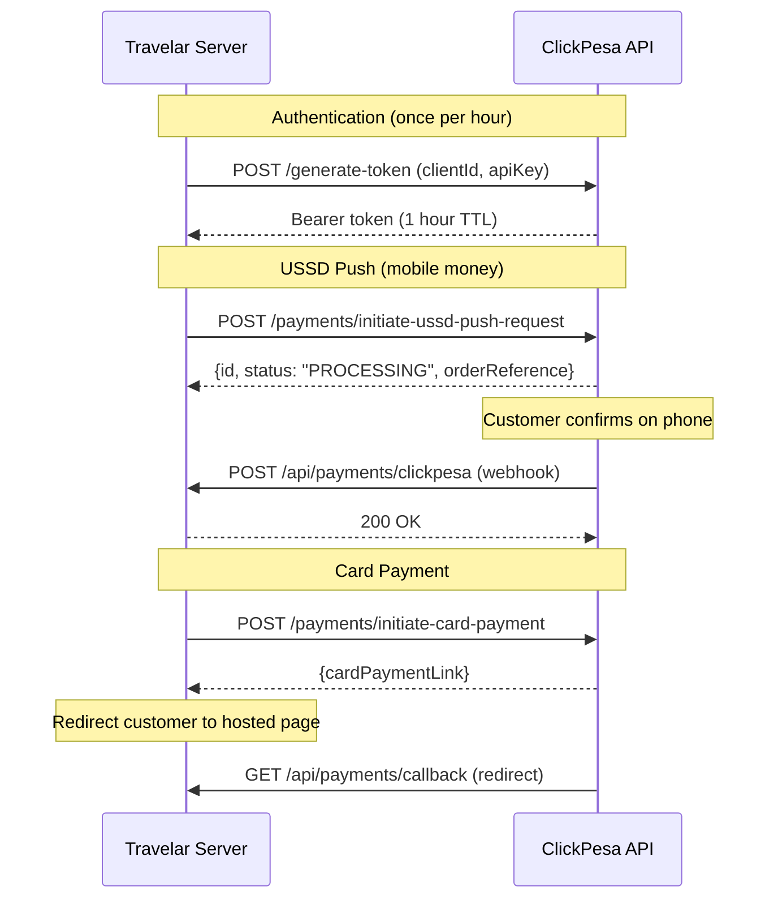

# 07 — API & Integration Audit

**Audit date:** 2026-11-01  
**Perspective:** Integration Engineer

---

## 1. Overall Assessment

The platform has **one live external integration** (ClickPesa payments) and **one planned integration** (Travelport for flights/stays). The ClickPesa integration is well-implemented with proper signing, idempotency, and error handling. The Travelport integration is config-only — no API calls are made.

**Grade: B** — ClickPesa integration is solid. Missing reconciliation and circuit-breaker patterns are the main gaps.

---

## 2. ClickPesa Payment Integration

### Architecture

### Strengths

| Aspect | Implementation | File | Lines |
|---|---|---|---|
| **HMAC signing** | Every request body is signed with a checksum computed over sorted fields | `checksum.ts` | 1-76 |
| **Timing-safe verification** | `timingSafeEqual` for webhook signature verification | `checksum.ts` | 56-64 |
| **Singleton token** | One token per process lifetime; prevents 429 rate limit errors | `clickpesa.ts` | ~50-80 |
| **Injectable fetch** | `fetchImpl` parameter enables complete testing without network calls | `clickpesa.ts` | 40-46 |
| **Status mapping** | Provider statuses mapped to internal states; no raw strings leak to business logic | `attempt-status.ts` | 1-18 |
| **Phone normalization** | Strips `+` prefix, validates Tanzania format | `phone.ts` | 1-59 |
| **Card currency gate** | Refuses non-USD card payments before calling the provider | `clickpesa.ts` | ~160-196 |
| **Idempotent confirmation** | Keyed on `(provider, order_reference)` — safe against webhook replays | `payments.ts` | — |

### Findings

| ID | Issue | Severity | Impact |
|---|---|---|---|
| M-009 | No reconciliation cron for unresolved payments | MEDIUM | A lost webhook = a paid-but-unissued ticket |
| M-013 | No circuit breaker for ClickPesa outages | MEDIUM | All payments fail during outages |
| — | No webhook retry mechanism documented | MEDIUM | ClickPesa's retry policy is unknown |
| — | Token refresh is lazy (on 401), not proactive | LOW | One request per hour may get a 401 before the token is refreshed |

### Provider Abstraction

**`src/server/payments.ts`** acts as the orchestrator. It:
1. Creates a `payment` row in `pending` state
2. Delegates to the ClickPesa adapter
3. Maps the provider's response to internal status
4. Handles the webhook callback (verify → update payment → update booking → write ledger)

The adapter pattern makes adding a second provider (e.g. Stripe, DPO) straightforward — implement the same interface, add a provider selector.

---

## 3. Travelport Integration (Flights/Stays)

### Current State: Config Only

**`src/server/travelport/config.ts` (150 lines)** — Well-designed configuration:

- Validates client credentials, environment, PCC/access group
- Throws on half-configuration (client ID without secret)
- Distinguishes pre-production from production endpoints
- `assertRequestReady()` refuses requests without a branch (PCC or access group)

**No API calls are made.** The flights and stays modes read entirely from fixture data in `src/data/mockData.ts`. The Travelport config module exists but nothing imports it in the booking flow.

### When Travelport Is Enabled

The config module is ready for integration. The next steps would be:
1. Implement OAuth2 client credentials flow against `authBaseUrl`
2. Implement search endpoints against `flightsBaseUrl` and `staysV11BaseUrl`
3. Wire the results into the search and booking flows
4. Replace fixture data with live API responses

---

## 4. Webhook Security

### ClickPesa Webhook (`/api/payments/clickpesa`)

| Check | Implementation | Verdict |
|---|---|---|
| Signature verification | HMAC-SHA256 checksum over body fields | ✅ Correct |
| Timing-safe comparison | `crypto.timingSafeEqual` | ✅ Correct |
| Replay protection | Idempotent on `(provider, order_reference)` | ✅ Correct |
| Status validation | Only processes terminal statuses (SUCCESS, FAILED) | ✅ Correct |
| Transaction safety | Payment update + booking update in one transaction | ✅ Correct |

### ClickPesa Callback (`/api/payments/callback`)

| Check | Implementation | Verdict |
|---|---|---|
| Signature verification | HMAC query string checksum | ✅ Correct |
| Redirect safety | Redirects to `/confirmation` with booking ID | ✅ Correct |

---

## 5. Error Handling in Integrations

### ClickPesa Error Mapping

| Provider Status | Internal Status | User-Facing Message |
|---|---|---|
| `SUCCESS` | `paid` | (Confirmed) |
| `PROCESSING` | `processing` | Awaiting approval |
| `FAILED` | `failed` | Provider refused |
| `CANCELLED` | `cancelled` | Payment cancelled |
| HTTP 400 | `not_found` | Treated as "not seen yet" — correct for race conditions |
| HTTP 5xx | `error` | Provider error |
| Network failure | `error` | Provider unreachable |

The status mapping is tested in `attempt-status.test.ts` and `clickpesa.test.ts`.

---

## 6. Internal API Routes

### Route Inventory

| Route | Method | Purpose | Auth | Idempotent |
|---|---|---|---|---|
| `GET /api/health` | GET | Readiness probe | None | ✅ |
| `POST /api/holds` | POST | Seat hold | **None** ⚠️ | ✅ (holdKey) |
| `POST /api/bookings` | POST | Booking commit | None | ✅ (hold) |
| `POST /api/payments/start` | POST | Payment initiation | Token | No |
| `POST /api/payments/clickpesa` | POST | Webhook | HMAC | ✅ |
| `GET /api/payments/callback` | GET | Redirect | HMAC | ✅ |
| `GET /api/booking-status` | GET | Status query | Token | ✅ |
| `POST /api/verify-ticket` | POST | Conductor verification | Token | ✅ |
| `POST /api/internal/sweep` | POST | Expiry sweep | Secret | ✅ |
| `GET /api/sgr/trips/:id/seats` | GET | Seat map | None | ✅ |
| `GET /api/sgr/trips/:id/quote` | GET | Pricing | None | ✅ |
| `GET /api/sgr/search` | GET | Train search | None | ✅ |
| `GET /api/search` | GET | Location search | None | ✅ |
| `GET /api/bus-results` | GET | Bus search | None | ✅ |

### API Design Quality

- Consistent JSON response format with `error` and `reason` fields ✅
- Correct HTTP status codes (400, 404, 409, 500) ✅
- Thin handlers that delegate to server modules ✅
- No GraphQL or OpenAPI specification (acceptable for this stage)

---

## 7. Recommendations

1. **Add a reconciliation cron** (M-009) — poll ClickPesa's status endpoint for payments stuck in `pending` > 15 minutes
2. **Add a circuit breaker** (M-013) — stop calling ClickPesa after N consecutive failures; surface "payments temporarily unavailable" to the UI
3. **Document ClickPesa's retry policy** — or implement server-side retry with exponential backoff
4. **Add request correlation IDs** — pass a unique ID from the API route through to the ClickPesa adapter and into logs
5. **Add an OpenAPI specification** — would enable automated client generation and contract testing

