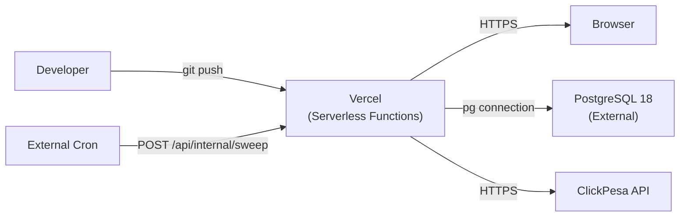

# 10 — DevOps & Infrastructure Audit

**Audit date:** 2026-11-01  
**Perspective:** DevOps and Infrastructure Engineer

---

## 1. Overall Assessment

The deployment infrastructure is **minimal but functional** for a single-environment Vercel deployment. There is no CI/CD pipeline, no containerization, no monitoring, no alerting, and no backup strategy. This is appropriate for early development but must be addressed before production.

**Grade: C+** — Deployable but not operable. No observability, no disaster recovery, no automated quality gates.

---

## 2. Deployment Architecture

### Current Setup



**`vercel.json`:**
- SPA fallback rewrite configured
- No custom headers, no edge config, no environment variable mapping

**`app.config.ts`:**
- TanStack Start with Vite, SSR enabled
- Production server via `srvx` (line in `package.json`)

### Strengths
- Serverless deployment is horizontally scalable for stateless requests ✅
- No local state — all state is in PostgreSQL ✅
- Clean separation between build artifacts and source ✅

### Weaknesses
- No staging environment documented
- No blue-green or canary deployment strategy
- No health check endpoint in Vercel cron configuration
- Database connection from serverless functions may exhaust pool under cold starts

---

## 3. CI/CD Pipeline

**Finding: No CI/CD pipeline exists.**

No configuration files found for:
- GitHub Actions
- GitLab CI
- CircleCI
- Jenkins
- Vercel build hooks with quality gates

### Impact
- No automated type checking before deploy
- No automated linting before deploy
- No automated tests before deploy
- A broken commit goes straight to production
- No dependency vulnerability scanning

### Recommendation

Minimum viable CI pipeline:

```yaml
# .github/workflows/ci.yml
on: [push, pull_request]
jobs:
  quality:
    runs-on: ubuntu-latest
    steps:
      - uses: actions/checkout@v4
      - uses: actions/setup-node@v4
      - run: npm ci
      - run: npm run typecheck
      - run: npm run lint
      - run: npm test
      - run: npm audit --audit-level=high
```

---

## 4. Environment Configuration

### `.env.example`

| Variable | Present | Required | Notes |
|---|---|---|---|
| `DATABASE_URL` | ✅ | ✅ | — |
| `CLICKPESA_CLIENT_ID` | ✅ | For payments | — |
| `CLICKPESA_API_KEY` | ✅ | For payments | — |
| `CLICKPESA_CHECKSUM_SECRET` | ✅ | For payments | — |
| `CLICKPESA_LIVE` | ✅ | — | — |
| `BOOKING_ACCESS_SECRET` | ❌ | ✅ | **H-001: Missing** |
| `SWEEP_SECRET` | ✅ | For cron | — |
| `TICKET_TOKEN_SECRET` | ✅ | For tickets | — |
| `TRAVELPORT_*` | ✅ | Optional | 10+ Travelport vars documented |

### Positive
- Secrets are in `.gitignore` ✅
- Config validation in `src/server/config.ts` throws on missing required values ✅
- Travelport config throws on half-configuration ✅

---

## 5. Containerization

**Finding: No Docker configuration exists.**

No `Dockerfile`, `docker-compose.yml`, or container orchestration files. The application is deployed directly to Vercel's serverless platform.

### Impact
- Cannot run locally with the same environment as production
- Cannot deploy to non-Vercel environments without adaptation
- No local development database setup documented (relies on external PostgreSQL)

### Recommendation
Add a `docker-compose.yml` for local development:
```yaml
services:
  db:
    image: postgres:18
    environment:
      POSTGRES_DB: travelar
      POSTGRES_USER: travelar_migrator
      POSTGRES_PASSWORD: dev
    ports:
      - "5432:5432"
```

---

## 6. Logging & Monitoring

### Logging

**Finding M-014: No structured logging.**

All logging is `console.log` / `console.warn`:
- No log levels (debug, info, warn, error)
- No structured format (JSON)
- No request correlation IDs
- No performance timing logs

In Vercel, `console.log` outputs appear in the function logs, but they are:
- Difficult to search
- Impossible to filter by severity
- Not correlated across function invocations

### Monitoring

**Finding: No monitoring or alerting.**

- No uptime monitoring (Pingdom, UptimeRobot, etc.)
- No error tracking (Sentry, Bugsnag, etc.)
- No performance monitoring (APM)
- No database monitoring
- No payment success/failure rate tracking
- No SLA or SLO defined

### Alerting

**Finding: No alerting configured.**

Critical events that should trigger alerts:
- Payment webhook failures
- Booking creation failures
- Database connection pool exhaustion
- Expiry sweeper failures
- ClickPesa API outages

---

## 7. Backup & Recovery

### Database

**Finding: No backup strategy documented.**

- No pg_dump schedule documented
- No point-in-time recovery configuration
- No WAL archiving mentioned
- No tested restore procedure

### Application State

Since all state is in PostgreSQL, database backup = application backup. But:
- No seed data restore procedure documented
- No migration rollback procedure (M-015)
- No disaster recovery playbook

---

## 8. Build Process

### `package.json` scripts

| Script | Command | Purpose |
|---|---|---|
| `dev` | `vinxi dev` | Local development |
| `build` | `vinxi build` | Production build |
| `start` | `vinxi start` | Production server |
| `typecheck` | `tsc --noEmit` | Type checking |
| `lint` | `eslint .` | Linting |
| `test` | `vitest run` | Unit tests |
| `test:e2e` | `playwright test` | E2E tests |

### Build Dependencies
- `vite@^8.0.0-beta.1` — **beta version** of a critical build tool
- No lockfile pinning strategy documented
- No `engines` field in `package.json` to enforce Node.js version

---

## 9. Security Infrastructure

| Control | Status | Priority |
|---|---|---|
| HTTPS | ✅ Via Vercel | — |
| CSP | ⚠️ Report-Only (H-008) | HIGH |
| CORS | ❌ Not configured (H-007) | HIGH |
| Rate limiting | ❌ None (H-006) | HIGH |
| Dependency scanning | ❌ None | MEDIUM |
| Secret rotation | ❌ No mechanism | MEDIUM |
| WAF | ❌ None | LOW |

---

## 10. Recommendations (Priority Order)

1. **Add CI pipeline** with typecheck, lint, test, and audit gates
2. **Add error tracking** (Sentry or similar) — most impactful operational improvement
3. **Add uptime and payment monitoring** — alert on failures
4. **Configure database backups** — daily pg_dump + WAL archiving
5. **Add structured logging** (M-014) — pino or winston with JSON output
6. **Add `docker-compose.yml`** for local development
7. **Document deployment runbook** — deploy, rollback, migration, seed procedures
8. **Pin Node.js version** in `package.json` `engines` field
9. **Replace Vite beta** with stable release when available
10. **Configure CORS** (H-007) and **enforce CSP** (H-008)

