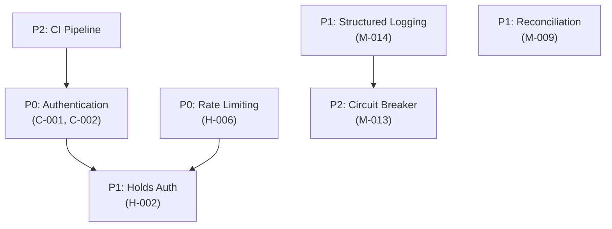

# 13 — Remediation Roadmap

**Audit date:** 2026-11-01

---

## Priority Legend

| Priority | Meaning | Timeline |
|---|---|---|
| **P0** | Must fix before any production traffic | Immediate (this sprint) |
| **P1** | Must fix before scaling or marketing | Next 2 weeks |
| **P2** | Should fix for operational readiness | Next 4 weeks |
| **P3** | Should fix for maintainability | Next quarter |
| **P4** | Nice to have; fix opportunistically | Backlog |

---

## P0 — Production Blockers

| # | Finding ID | Title | Effort | Risk | Dependencies |
|---|---|---|---|---|---|
| 1 | C-001, C-002 | **Implement real authentication & authorisation** | 1-2 weeks | HIGH — all admin/operator access is unprotected | None |
| 2 | H-001 | **Add `BOOKING_ACCESS_SECRET` to `.env.example`** | 5 minutes | LOW | None |
| 3 | M-001 | **Gate fixture-backed modes** (flights, stays, experiences) | 2 hours | LOW | None |
| 4 | H-006 | **Add rate limiting to API endpoints** | 1 day | MEDIUM | None |

### P0 Detail

**#1 — Authentication (C-001, C-002):**
- Choose provider: Keycloak (per ADR-0005) or Supabase Auth (dependency already listed)
- Implement server-side session/JWT validation middleware
- Gate all OIMS/HIMS routes behind operator/admin roles
- Guest booking flow can remain tokenless (access token is sufficient)
- **Acceptance criteria:** Cannot access OIMS/HIMS without login; operator role required

**#3 — Gate fixture modes (M-001):**
- Add a "Coming Soon" badge to non-live mode cards
- Disable the "Book Now" / "Pay" button for fixture-backed modes
- Alternatively: remove non-live modes from the production build entirely
- **Acceptance criteria:** No payment can be initiated for a fixture-backed booking

---

## P1 — Security & Reliability

| # | Finding ID | Title | Effort | Risk | Dependencies |
|---|---|---|---|---|---|
| 5 | H-002 | **Add auth/CAPTCHA to `/api/holds`** | 4 hours | LOW | P0 #4 (rate limiting) |
| 6 | H-003 | **Fix SQL string interpolation in `search.ts`** | 15 minutes | LOW | None |
| 7 | H-007 | **Configure CORS headers** | 2 hours | LOW | None |
| 8 | H-008 | **Enforce CSP (remove Report-Only)** | 1 hour | LOW — verify report logs first | None |
| 9 | M-009 | **Add payment reconciliation cron** | 1 day | MEDIUM | ClickPesa status endpoint access |
| 10 | M-014 | **Add structured logging** | 1 day | LOW | None |

### P1 Detail

**#6 — Fix SQL interpolation (H-003):**
```typescript
// Before (search.ts line ~63):
`...LIMIT ${limit}`

// After:
`...LIMIT $${paramIndex}`  // with limit added to the params array
```

**#9 — Payment reconciliation (M-009):**
- Add a cron job (Vercel cron or external) that runs every 15 minutes
- Query payments in `pending` status older than 15 minutes
- For each: call ClickPesa's status endpoint
- If confirmed at provider but not locally: process the confirmation
- If failed at provider: mark payment as failed and notify

---

## P2 — Operational Readiness

| # | Finding ID | Title | Effort | Risk | Dependencies |
|---|---|---|---|---|---|
| 11 | — | **Add CI/CD pipeline** (typecheck, lint, test, audit) | 4 hours | LOW | None |
| 12 | — | **Add error tracking** (Sentry or similar) | 2 hours | LOW | None |
| 13 | — | **Add database backup strategy** | 4 hours | MEDIUM | Database provider |
| 14 | M-006 | **Configure connection pool limits** | 30 minutes | LOW | None |
| 15 | — | **Add uptime monitoring** | 1 hour | LOW | None |
| 16 | M-013 | **Add circuit breaker for ClickPesa** | 4 hours | MEDIUM | M-014 (logging) |
| 17 | — | **Document deployment runbook** | 2 hours | LOW | None |
| 18 | — | **Add `docker-compose.yml` for local dev** | 1 hour | LOW | None |

---

## P3 — Maintainability

| # | Finding ID | Title | Effort | Risk | Dependencies |
|---|---|---|---|---|---|
| 19 | H-005 | **Extract I18n to JSON files** | 2-3 days | LOW | None |
| 20 | H-004 | **Rename `amountMinor` to `amount`** | 1-2 days | MEDIUM — DB migration + full codebase rename | All tests passing |
| 21 | M-005 | **Consolidate duplicate error classes** | 2 hours | LOW | None |
| 22 | M-002 | **Fix `cancelBookingSeats` coalescing** | 2 hours | LOW | None |
| 23 | M-011 | **Fix duplicate React keys in CoachSeatMap** | 1 hour | LOW | None |
| 24 | M-012 | **Fix or annotate useEffect dependency warnings** | 1 hour | LOW | None |
| 25 | M-008 | **Derive phone prefix from market config** | 1 hour | LOW | None |
| 26 | M-004 | **Use `sumLines` in `quoteFerrySailing`** | 15 minutes | LOW | None |
| 27 | M-010 | **Compute Express total from layout array** | 15 minutes | LOW | None |
| 28 | M-003 | **Clarify `quoteFlight` passengerCount usage** | 30 minutes | LOW | None |

---

## P4 — Future Enhancements

| # | Finding ID | Title | Effort | Risk | Dependencies |
|---|---|---|---|---|---|
| 29 | L-002 | **Optimize Vitest with `pool: 'vmThreads'`** | 15 minutes | LOW | None |
| 30 | L-001 | **Add favicon and PWA manifest** | 1 hour | LOW | None |
| 31 | L-005 | **Add `robots.txt` and sitemap** | 30 minutes | LOW | None |
| 32 | L-006 | **Remove unnecessary `pgcrypto` extension** | 15 minutes | LOW | None |
| 33 | L-004 | **Split `ReceiptPrinter.tsx` exports** | 30 minutes | LOW | None |
| 34 | M-015 | **Add down migration support** | 1 day | MEDIUM | Migration runner |
| 35 | — | **Add OpenAPI specification** | 2 days | LOW | None |
| 36 | — | **Add keyboard navigation to seat maps** | 1 day | LOW | None |
| 37 | — | **Add caching layer for read models** | 2 days | MEDIUM | Redis or Vercel KV |
| 38 | — | **Batch SGR search queries (eliminate N+1)** | 4 hours | LOW | None |
| 39 | — | **Add index on `sgr_trip_stops(station_id)`** | 15 minutes | LOW | None |

---

## Effort Summary

| Priority | Items | Total Effort |
|---|---|---|
| P0 | 4 | ~2 weeks (dominated by auth) |
| P1 | 6 | ~4 days |
| P2 | 8 | ~3 days |
| P3 | 10 | ~5 days |
| P4 | 11 | ~6 days |
| **Total** | **39** | **~5 weeks** |

---

## Dependency Graph



Auth is the critical path. Everything else can proceed in parallel.

