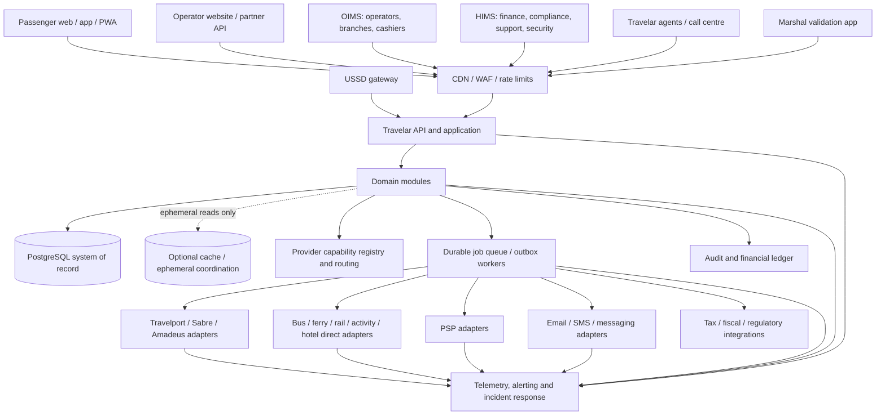

# 19 — System Context and Integration Architecture

> **Stage 14 product-scope clarification (24 October 2026):** Train and Experiences are first-class Travelar modes, not future modes. Their requirements belong in the current product, architecture, integration and test baseline. Per-country activation may remain gated until authorized suppliers, contracts, ticket/voucher flows and support/refund handling are verified. See `40-train-and-experiences-first-class-mode-research.md`.

**Product:** Travelar  
**Parent company:** OuterBlocks Limited
**Intended operating entity:** OuterBlocks Destinations Limited (formal verification required)  
**Status:** Recommended logical architecture; implementation decisions remain conditional on legal, supplier and hosting evidence  
**As of:** 23 October 2026

## 1. Purpose and constraints

Travelar is a multi-mode travel commerce platform with public web/mobile experiences, an operator operating system (OIMS), headquarters/internal management (HIMS), Travelar sales agents, operator agents/cashiers, call-center staff, boarding marshals and planned USSD channels. It must connect to transport operators, global travel distributors, accommodation/activity suppliers, PSPs, email/SMS providers, tax/fiscal systems and country regulators.

The architecture must preserve these owner-confirmed directions:

- Product brand: **Travelar**; parent: **OuterBlocks Limited**; intended operating entity: **OuterBlocks Destinations Limited**, subject to documentary verification.
- Bus availability is segment-aware; ferry inventory is based on sailing/class capacity by default.
- Travelport, Sabre and Amadeus can coexist through adapters.
- Payment providers and communications providers also use adapters; alternate providers support controlled failover.
- Marketplace and operator-originated bookings have distinct commercial attribution.
- Browser redirects, mocked integrations and API acceptance responses are not proof of payment, ticket issuance or message delivery.
- The 100-million-user ambition is a long-term planning goal, not a launch-scale fact or an established load target.

## 2. Logical context

The diagram is logical, not a final deployment topology. The “queue” can initially be a managed durable queue plus a PostgreSQL outbox; it does not imply a commitment to Kafka or a fleet of microservices.

## 3. Recommended logical modules

Start with a **modular monolith** organized by domain boundaries. A single application deployment may contain these modules while preserving independent contracts and dependency direction:

1. **Identity and access:** accounts, sessions, MFA, invitations, roles, permissions, service identities.
2. **Organizations and tenancy:** OuterBlocks, country environments, operators, branches, suppliers, partner apps.
3. **Catalog:** routes, stops, stations, ports, properties, activities, locations, currencies, languages, amenities and supplier references.
4. **Schedules and inventory:** trip instances, route legs, bus seats, ferry class capacity, rail/hotel/activity availability snapshots and holds.
5. **Offers and pricing:** provider offers, price revalidation, market rules, contract versions, taxes, commissions, markups, promotions and currency conversion source/time.
6. **Booking orchestration:** booking aggregate, items, supplier references, idempotency and partial-failure recovery.
7. **Payments and refunds:** intents, transactions, normalized events, refund lifecycle, PSP adapter calls and reconciliation.
8. **Ticketing and fulfilment:** provider ticket references, QR tokens, manifests, boarding, vouchers, supplier confirmations and fulfilment status.
9. **Accounting:** immutable posted journals, subledgers, payables, clearing, settlements, suspense and reconciliation.
10. **Communications:** notification intent, template, provider routing, delivery status and opt-out rules.
11. **OIMS:** fleet/vessel configuration, branches, staff, counter sales, shift close, operator reports and onboarding.
12. **HIMS and support:** supplier approvals, configuration approvals, complaints, disruption handling, finance operations and security workflows.
13. **Audit and policy:** security/financial audit events, approval trails, policy versions, retention and legal holds.
14. **Integration operations:** provider credentials references, capability registry, health, rate limits, circuit breakers, dead-letter queues and adapter versions.

Modules may share a PostgreSQL cluster at first, but should not read or write each other's tables arbitrarily. Each module owns its write model and exposes application services or explicit interfaces. Cross-module transactions are minimized; where atomicity matters, keep the involved writes in one database transaction and use an outbox for external work.

## 4. Synchronous versus asynchronous operations

### Synchronous path

Use synchronous operations for interactions where the customer needs a deterministic response and a short bounded operation is feasible: search request validation, price/availability revalidation, reservation creation, internal inventory claims, permission checks and booking retrieval.

Supplier calls can be slow or time out. A synchronous HTTP timeout means “outcome unknown” in some cases, not “supplier did nothing”. Record an operation attempt and reconcile with the provider using its reference/idempotency support before retrying an irreversible action.

### Asynchronous path

Use durable asynchronous jobs for confirmations, email/SMS, retryable supplier follow-up, reconciliation files, payout investigations, analytical events, schedule refresh, tax submission retries and long-running changes. Persist the business event in the same transaction as the state change using a transactional outbox, then publish/process it. Consumers must be idempotent.

Do not perform a PSP call, supplier API call, SMS send or external fiscal submission inside a long-running database transaction. Never hold a seat/capacity row lock while waiting for a remote provider.

## 5. Source-of-truth boundaries

| Data or state | Authoritative source | Travelar responsibility |
|---|---|---|
| Internal bus seat/segment inventory when OIMS is primary | Travelar PostgreSQL transaction and constraints | Allocate/release atomically; expose authoritative remaining availability. |
| External operator inventory | Contracted operator system or approved ticketing system | Treat adapter response as external authority; revalidate before committing. |
| Ferry capacity for direct OIMS operators | Travelar's sailing/class inventory, updated by authorized operator action | Capacity invariant per sailing/class/passenger category. |
| GDS reservation/ticket | Relevant GDS/airline/consolidator | Persist provider references and reconcile ticket status. |
| PSP transaction | PSP plus verified server-to-server status/settlement report | Normalize evidence; do not infer status from browser redirect. |
| Accounting journals | Travelar's financial ledger after posting controls | Immutable entries, balanced batches, versioned rules and auditable reversals. |
| Communications delivery | Provider delivery events/queries with limitations | Record acceptance separately from delivery and recipient reading. |
| Regulatory approval | Regulator-issued record/certificate | Store verification date, scope, evidence and renewal/suspension status. |

Travelar should distinguish the **business record** (for example, booking) from provider evidence (a PSP reference or external booking ID) and from accounting effect (journal entries). None should overwrite the others silently.

## 6. Multi-provider registry and routing

A provider registry should record: provider and product family; supported modes; markets/countries; currencies; content/supplier coverage; operation capabilities; permitted sales channels; authentication method; rate limits; contract/permit status; certification state; credential secret reference; health state; API version; settlement model; refund/after-sales coverage; effective dates; support tier; data-sharing/transfer terms; and production enablement approvals.

Routing should select only providers that are **eligible for the specific operation**, not merely “healthy”. Search may fan out to multiple adapters; booking, ticketing, refund and post-booking service must remain tied to the provider that owns the original reservation unless a documented transfer workflow exists. A failover payment provider must not automatically charge a second provider if the first attempt's outcome is uncertain.

## 7. Trust boundaries

Trust boundaries include public clients, operator/partner credentials, internal privileged tools, background workers, provider networks, country-specific data environments, and backups/telemetry. Treat every inbound request and every provider response as untrusted until authenticated, validated and correlated to a known operation. Avoid sending full passenger records to monitoring or communication providers where a minimal payload/reference suffices.

## 8. Architecture exit criteria

Before implementation approval:

- Identify the authorised production supplier path for each initial mode.
- Select the transactional system of record for each inventory type and document conflict resolution.
- Complete booking/payment/ticket state diagrams and failure/recovery cases.
- Decide hosting/data-flow model after legal review and vendor due diligence.
- Demonstrate segment and ferry-capacity concurrency tests at agreed launch load.
- Define API versioning, adapter capability contracts and secret handling.
- Assign operational owners for on-call, provider incidents, reconciliation and disaster recovery.

## 9. Sources

- PostgreSQL 18 locking documentation: https://www.postgresql.org/docs/18/explicit-locking.html
- PostgreSQL 18 transaction blocks: https://www.postgresql.org/docs/18/sql-begin.html
- OpenTelemetry documentation: https://opentelemetry.io/docs/
- Supabase platform region list: https://supabase.com/docs/guides/platform/regions
- PDPC Tanzania cross-border transfers: https://pdpc.go.tz/services/cross-border-data-transfer-permit/

## Stage 20 delta — regulatory/fiscal adapters and commerce channels

Add an evidence-gated regulatory integration boundary for LATRA/Safari Tiketi and TRA EFDMS/VFD; the capabilities catalogued in Document `52` are possible interface slots, not claims of public API availability. Production submission, ticket registration, manifest or fiscal flows require current specifications, legal eligibility, test acceptance and production approval. If a legally mandatory capability is unavailable, the transaction must follow an approved continuity path or be blocked; no silent bypass.

The 2026 mandatory electronic-payment Order (GN 158C) requires an effective-dated payment-method policy for relevant bus/ferry/air/rail, hotel and tourism transactions. See `ADR-REG-002`. Preserve current supplier/provider access gates. For each mode/supplier, decide whether OIMS owns inventory or merely manages authorized integration configuration and exceptions; supplier inventory authority is not universal.
