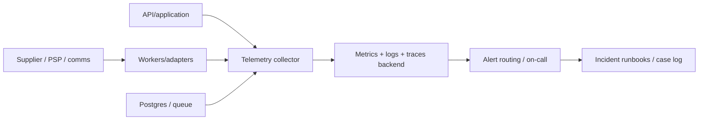

# 26 — Observability, Incident Response and Disaster Recovery

**Product:** Travelar | **Parent company:** OuterBlocks Limited
**Intended operating entity:** OuterBlocks Destinations Limited (formal verification required) | **Status:** Operational design proposal; targets require owner approval and hosting evidence | **As of:** 23 October 2026

## 1. Principles

- Observe customer and business outcomes, not just server uptime.
- Keep provider-specific evidence and normalize states without losing the original reason/status.
- Use correlation IDs across APIs, workers, adapters, webhooks, tickets, PSPs and ledger source events.
- Avoid PII/payment data in logs and traces; security monitoring still needs enough metadata to investigate abuse.
- Treat backups, restore tests and reconciliations as production capabilities, not future housekeeping.
- Design incident response before adding high-risk automation. Freeze/hold actions must have guardrails, ownership and an audited recovery path.

## 2. Telemetry architecture

Use OpenTelemetry-compatible tracing, metrics and structured logs where possible. OpenTelemetry is a vendor-neutral framework/toolkit for generating, collecting and exporting telemetry; it is not a storage/visualization backend itself. Source: https://opentelemetry.io/docs/what-is-opentelemetry/.

The final backend depends on data residency, provider contracts, staff capability and budget. Instrumentation should remain portable.

## 3. Required service-level indicators

| Area | SLI / signal | Example alert condition (threshold must be tuned) |
|---|---|---|
| Public API | Availability, p95/p99 latency, error rate by route/mode/market | Error budget burn or latency over agreed window. |
| Search/providers | Success/partial result rate, per-provider latency, timeout/rate limit, price revalidation failure | One provider failing or aggregate search service degraded. |
| Inventory | Claim conflict rate, hold age/expiry, availability mismatch, seat/leg uniqueness violation | Any invariant violation is severity 1; unusual conflict spike investigated. |
| Booking/fulfilment | Counts and age of payment-pending, paid-not-ticketed, ticket-unknown and supplier-pending bookings | Old pending state above mode/provider recovery window. |
| Payments | Verified success/failure, webhook lag, unknown outcome, duplicate event, charge/refund mismatch | Unmatched value/count exceeding approved threshold; any unauthorized status mutation. |
| Accounting | Unbalanced journal posting, missing posting for a financial event, unreconciled suspense by age/value | **Any unbalanced posted journal is critical**; missing posting beyond agreed short threshold alerts. |
| Payouts/settlements | Expected vs actual amount, currency, unmatched provider/operator statement rows | Settlement file absent past due time or unexplained delta. |
| Communications | Acceptance, delivery, bounce/failure, provider event lag, duplicate send, cost per channel | Provider-specific delivery failures or all fallback routes down. |
| Identity/security | failed logins, MFA challenge failure, privileged action, denied cross-tenant requests, API scraping | Thresholded anomaly plus immediate high-risk privileged changes. |
| Data/infra | DB pool, locks, replication lag, disk, queue depth, backup age/result | Critical resource exhaustion or missed backup/replication objectives. |
| DR | Last restore rehearsal, restore duration, achieved RPO/RTO, missing dependencies | Restore evidence stale or RPO/RTO miss. |

Set metric labels carefully to avoid unbounded cardinality: never label with raw booking references, phone numbers, IDs, emails or full provider payloads. Use sampled/redacted trace IDs and hashed/correlated internal IDs where lawful.

## 4. Audit versus telemetry

Operational logs, business audit records and accounting journals are different systems of evidence:

- **Telemetry** diagnoses latency/errors and may be sampled/retained for limited time.
- **Audit events** record who did what, when, to which resource, under which permission/approval, and result. These require controlled access/retention and tamper-evident protection.
- **Financial ledger** contains posted economic effects. It must balance and be corrected by linked reversals/adjustments, not deleted or edited to make a report look right.

Do not use a metrics database as a ledger or assume a hash chain alone makes logs immutable. Protect signing keys/checkpoints, storage administration and backups independently.

## 5. Incident severity and response ownership

| Severity | Example | Response owner | Required first actions |
|---|---|---|---|
| SEV-1 critical | Customer funds taken without fulfilment at scale; ticket double-issuance; cross-tenant passenger leak; ledger integrity compromised; credentials with active abuse | Incident Commander + Engineering/Security + Finance/Operations as relevant | Declare; preserve evidence; contain with least harmful action; stop affected writes/payouts only under approved policy; inform executives/legal; start reconciliation. |
| SEV-2 high | One major provider/mode unavailable, unexplained settlement gaps, elevated refund failure, suspicious privileged access | Duty owner + module owner | Open incident, activate workaround/provider route, alert affected partners, track impact and backlog. |
| SEV-3 moderate | Partial degradation, isolated delivery issue, noncritical queue lag | Service owner | Triage and restore normal service; monitor for escalation. |
| SEV-4 low | Cosmetic/internal error with no transaction or data impact | Product/engineering | Track through normal backlog. |

Owner names, contact channels, after-hours coverage and backup responders must be filled before production; a policy without named people is not an operational plan.

## 6. Incident playbooks required

1. **PSP ambiguous/success-but-no-ticket:** mark outcome uncertain; query original PSP; query supplier/fiscal state; prevent duplicate charge; keep inventory under approved hold/recovery policy; refund/compensate only through approved flow; reconcile the ledger.
2. **Supplier/GDS outage:** stop retries when provider may have accepted a write; circuit-break; search eligible providers only for new offers; keep post-booking service tied to original provider; notify operators/support.
3. **Inventory mismatch/double booking:** pause affected trip/route if appropriate; preserve claim/audit evidence; identify external channel sales; contact operator; recover passenger; reconcile seat/leg claims and prevent a second over-sale.
4. **Payment/refund fraud:** retain provider IDs, access logs and approvals; suspend high-risk operation using maker-checker and an expiry/review; preserve business continuity for unaffected payments.
5. **Personal-data incident:** contain access/exfiltration, preserve logs, determine data/countries/subjects/recipients, involve DPO/legal, determine notification duties/timeframes for each jurisdiction, document regulator/customer/provider communications.
6. **Credential leak:** revoke/rotate affected provider/service secrets, determine use period and side effects, validate webhook legitimacy, review deployments and audit logs, issue clean replacements.
7. **Ransomware/database incident:** isolate compromised workloads, preserve evidence, use separate backup credentials, rebuild from known-good artifacts, restore to clean environment, validate access and reconcile booking/money events.
8. **Communication provider outage:** check independent alternate capability/consent/sender-ID; avoid sending duplicates during unknown states; show ticket in secure account/booking retrieval and use manual support path.
9. **Marshal device lost/offline abuse:** revoke device identity, expire manifest cache/keys where possible, investigate events synced from device, notify privacy/security owner if manifest exposed.
10. **Unlawful/unauthorized data transfer:** suspend the affected flow without deleting evidence, isolate recipient/access, contact legal/DPO and regulator per applicable duty, document remediation.

## 7. Recovery objectives and backups

Proposed starting objectives for design discussion (not commitments):

| Workload | Candidate RPO | Candidate RTO | Notes |
|---|---|---|---|
| Booking/inventory and ticket issue evidence | ≤5 minutes of recoverable data loss; ≤4 hours service restoration | Must be stress-tested; loss of acknowledged events also reconciled externally | Correctness takes priority over silent fast recovery. Stricter requirement may be needed for a chosen operator/regulator. |
| Payment status, refunds and posted financial entries | ≤5 minutes as a DR target plus external PSP/settlement reconciliation; ≤4 hours | Ledger must replay/reconcile idempotently; no missing/unbalanced posted record silently accepted | Evaluate more stringent zero-loss requirement and replication cost with Finance/hosting vendor. |
| Public discovery/catalog | ≤24 hours if source catalogs can be regenerated | ≤8 hours | Restore from source/provider feed/cache can be acceptable. |
| HIMS audit/approval evidence | ≤5 minutes | ≤8 hours | Retention/location must meet legal obligations; export independently. |
| Notifications | Queue may replay; don't guarantee same-day delivery without provider | ≤8 hours for worker service | Duplicate suppression and recipient preferences must remain effective. |

These are proposed targets to cost and approve. Final RPO/RTO must match business impact, law/regulator terms, hosting/provider SLA and restore test results.

Backup/DR requirements:

- Document backup coverage for database, WAL/PITR, object storage, configuration, encryption keys/recovery materials, secrets metadata, source artifacts, and audit evidence.
- Keep at least one copy in a separate security boundary; encryption and access/delete rights separate from production admin where feasible.
- Document each backup/replica location in country-transfer analysis.
- Run regular automated backup-verification checks and scheduled restore drills; a successful backup job alone is not proof restore works.
- Measure actual recovery time, missing transactions, provider webhook replays, ledger balances, inventory holds and public ticket retrieval after restore.
- Keep migration/runbook instructions and infra-as-code outside the same failure domain as production.
- Define retention/deletion and legal hold for backups; delete on schedule without violating record-retention obligations.

## 8. NIST-aligned incident lifecycle

Use NIST SP 800-61 Rev. 3, finalized April 2025, as the incident-response baseline aligned to CSF 2.0: https://csrc.nist.gov/pubs/sp/800/61/r3/final.

For each incident, record: detection source; event timeline in UTC; affected countries/modes/tenants; data/financial impact estimate; containment actions and approvals; evidence custodians; external provider/regulator/customer notifications and legal reasoning; recovery verification; reconciliation results; lessons and tracked corrective actions.

## 9. Automation controls

Automate alerting, correlation, safe retries, circuit breakers and low-risk temporary rate limiting. Use caution with automatic account locks, payout suspensions, booking cancellation, credential changes or bulk deletion. Any automated high-impact containment must have explicit trigger evidence, bounded duration, alerting, audit, override and human review. Never automatically execute an irreversible financial action solely from a single anomaly score or provider timeout.

## 10. Sources

- OpenTelemetry docs: https://opentelemetry.io/docs/
- NIST SP 800-61 Rev. 3 (2025): https://csrc.nist.gov/pubs/sp/800/61/r3/final
- Supabase backups/PITR if selected: https://supabase.com/docs/guides/platform/backups
- OWASP Top 10 2025: https://owasp.org/projects/top-ten/

## Stage 16 security operations addition

Use `42-cybersecurity-self-defence-detection-and-response-architecture.md` as the security-specific extension to this observability, incident response and disaster recovery plan. It adds the security event-source inventory, alert catalogue, monitor-health alerts, automatic-containment policy, escalation requirements, recovery reconciliation checks, independent assessment gate and security readiness evidence. The chosen logging/alerting provider is not yet selected; selection must respect hosting contracts, data-flow/transfer requirements, on-call capability, retention, alert routing, evidence export and recovery constraints.
