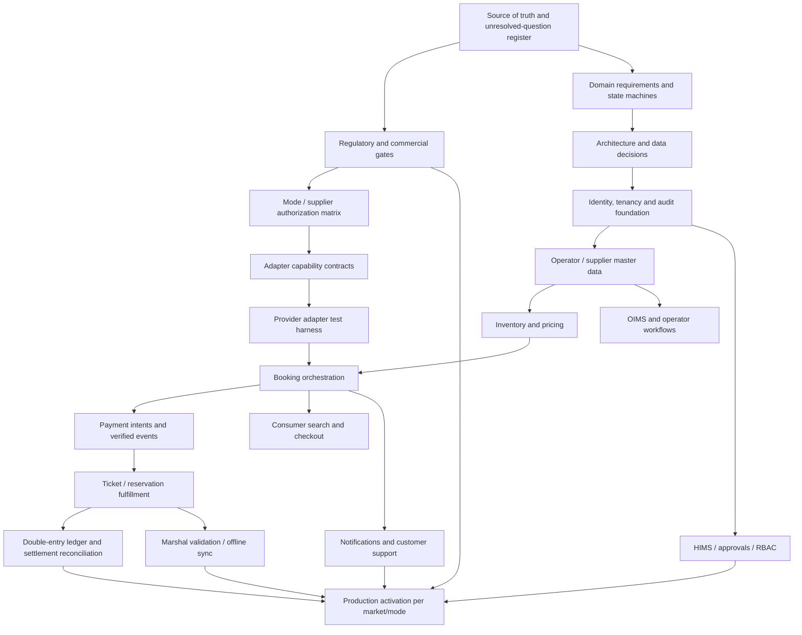

# 27 — Build Sequence and Dependency Graph

> **Stage 14 product-scope clarification (24 October 2026):** Train and Experiences are first-class Travelar modes, not future modes. Their requirements belong in the current product, architecture, integration and test baseline. Per-country activation may remain gated until authorized suppliers, contracts, ticket/voucher flows and support/refund handling are verified. See `40-train-and-experiences-first-class-mode-research.md`.

**Product:** Travelar  
**Parent company:** OuterBlocks Limited
**Intended operating entity:** OuterBlocks Destinations Limited (formal verification required)  
**Status:** Proposed roadmap; no development authorization implied  
**Updated:** 23 October 2026

## 1. Purpose and governing rule

This roadmap converts research into a dependency-aware delivery sequence. It does not declare supplier access, licences, payment arrangements, hosting locations, or internal operating procedures approved. Each such item stays an external gate until supported by documentary evidence and an accountable owner.

Travelar's build order is governed by two principles:

1. Resolve the domain and commercial truth before hardening an implementation around it.
2. Establish correctness, security and recoverability before scaling or adding distribution channels.

A finished landing page is not a functioning travel marketplace. A provider adapter that passes mocks is not a production integration. A booking row is not a confirmed ticket. Gross booking value is not automatically Travelar revenue.

## 2. External launch gates

| Gate | Required evidence | Owner to assign | Blocks |
|---|---|---|---|
| G0 — Corporate and activity scope | Verified OuterBlocks Limited records, licences/business activity classification and tax setup | Executive + legal/accounting adviser | Contracting and regulated operations |
| G1 — Transport authorization | Written LATRA classification and required ticketing path; operator/vessel/route permissions; Zanzibar-specific assessment where relevant | Regulatory lead + operator partnerships | Production bus/ferry ticket issuance |
| G2 — Supplier rights | Signed agreements, permitted channel, market/supplier coverage, production credentials, booking/ticketing/post-sale authority, support and settlement terms | Supplier partnerships | Each supplier/mode activation |
| G3 — Funds flow | Approved merchant/agency model, PSP underwriting, receipt/payout/refund roles, tax treatment and dispute responsibility | Finance + legal + PSP | Live payments and supplier payouts |
| G4 — Data and hosting | PDPC/ODPC and other applicable registrations/transfer reviews; chosen regions; processor contracts; retention and breach procedures | Privacy lead + platform lead | Real personal-data production use |
| G5 — Operational readiness | Named support/incident owners, finance reconciliation, tested restore, supplier outage procedures and customer communications | Operations + finance + security | Public production launch |

A gate may apply differently by country, mode, provider or channel. Record the evidence and scope of approval rather than a vague global “approved” flag.

## 3. Dependency graph

The graph is conceptual. Some lanes can progress in parallel, but production activation remains blocked by applicable external gates and end-to-end acceptance.

## 4. Parallel workstreams

**Can run in parallel after requirements are baselined:** visual design system and public sitemap; operator discovery; RFI/vendor applications; domain-model review; security threat modelling; sample provider contract tests; hosting and legal data-flow assessment; chart of accounts review.

**Must not be treated as parallel independent decisions:** inventory allocation and booking transaction design; PSP events and booking state; ticket issuance and supplier contracts; commission recognition and signed commercial terms; data-region choice and cross-border assessment; offline marshal conflict policy and ticket-validation design.

## 5. Dependency-ordered implementation stages

| Stage | Objective | Entry condition | Exit / acceptance evidence |
|---|---|---|---|
| 0. Governance | Freeze source of truth, owners, evidence classification and decisions process | Research bundle available | Approved baseline, decision log and known blockers |
| 1. Foundations | Repositories, CI, environments, secrets, lint/type-check, tests, migrations, observability primitives | Hosting and stack selection sufficiently validated for non-production | Repeatable build/deploy/rollback in non-production; no production secrets in code |
| 2. Identity and tenancy | Auth integration, organizations, membership, RBAC/ABAC, audit and approval primitives | Actor and tenant model approved | Negative authorization tests pass across tenants/roles |
| 3. Catalog and operator setup | Markets, currencies, operators, branches, stops/ports/stations, fleet/vessels, classes, routes, schedules | Data owners and onboarding requirements identified | Tenant-isolated setup, versioned configuration, audit trail |
| 4. Inventory and pricing | Segment-aware bus inventory, ferry class capacity, supplier availability, fare/rate versioning and holds | Core domain rules approved | Concurrency, expiry, schedule-change and reconciliation tests pass |
| 5. Booking orchestration | Common booking aggregate plus mode-specific workflows and external reservation linkage | Inventory and adapter contracts stable | State transitions enforced and recoverable; unknown outcomes reconciled |
| 6. Payments | PSP adapters, verified server events, idempotency, refund workflow and payment/booking reconciliation | G3 funds-flow/PSP approval for test/production scopes | Fault-injection and duplicate-event tests pass; live mode remains disabled without approval |
| 7. Fulfilment and ledger | Ticket/voucher issuance, double-entry journals, commissions, supplier payable and settlement | Contractual earning events and accounting policy reviewed | No unbalanced journals; tickets only in authorized fulfilment state |
| 8. Consumer web | Search, results, checkout, guest/registered bookings, secure retrieval and accessible UI | Mode/provider entitlements configured | E2E booking path passes for each launched mode and failure state |
| 9. OIMS / HIMS / agents | Operator workflows, approvals, branch sales, agent attribution, finance reports and admin controls | Role matrix and commercial rules signed off | Permission and maker-checker test suite passes; commission disputes traceable |
| 10. Communications and support | Email/SMS adapters, delivery events, failover, customer case management and templates | Provider/sender rights and privacy rules known | Provider outage and duplicate-notification tests pass |
| 11. Marshal / offline | Device enrolment, manifest scope, QR validation, offline queues and conflict rules | Offline risk policy approved by operators | Duplicate-board scenarios and sync conflicts tested on representative devices |
| 12. USSD | Aggregator adapter, session state, auto-allocation/capacity, interrupted-session recovery | Telecom contracts, pricing and supported payments approved | Simulated interruption/retry tests pass; no bypass of backend controls |
| 13. Production readiness | Load/failure tests, vulnerability review, restore drill, finance close, support training and rollback | Applicable gates G0–G5 satisfied | Formal go/no-go evidence packet approved by named owners |
| 14. Expansion and scale | Add markets/providers and introduce replicas/partitioning/services only from measured need | Initial production meets targets with operational evidence | Country-specific launch checklist and capacity evidence for every expansion |

## 6. Launch scope control

The minimum launch is not defined by the smallest set of screens. It is the smallest **lawful, contractually supportable, operationally recoverable end-to-end booking path** for the selected mode and suppliers.

A narrower launch may be preferable—for example, a limited set of authorized bus operators and routes—only if all applicable ticketing, payment, passenger-data, finance, cancellation, support, reconciliation, security and recovery obligations are satisfied. Do not launch a mode because its interface is complete.

## 7. Go/no-go review pack

For each market/mode/provider combination, assemble: regulator/legal evidence; supplier contract and production access evidence; approved funds flow; privacy/hosting assessment; test run report; inventory concurrency report; PSP fault-recovery report; ledger/reconciliation sign-off; support and disruption runbook; security finding disposition; backup restore and rollback evidence; alert routing and on-call ownership; customer terms/refund disclosure; and explicit sign-offs.

## 8. Sources informing the delivery governance

- NIST Secure Software Development Framework (SSDF), SP 800-218: https://csrc.nist.gov/pubs/sp/800/218/final
- OWASP ASVS 5.0.0: https://asvs.owasp.org/
- OWASP API Security Top 10 2023: https://devguide.owasp.org/en/07-training-education/07-api-top-ten/
- NIST SP 800-61 Rev. 3, Incident Response: https://csrc.nist.gov/pubs/sp/800/61/r3/final
- OpenTelemetry documentation: https://opentelemetry.io/docs/

These are engineering references, not substitutes for country-specific legal or supplier requirements.
